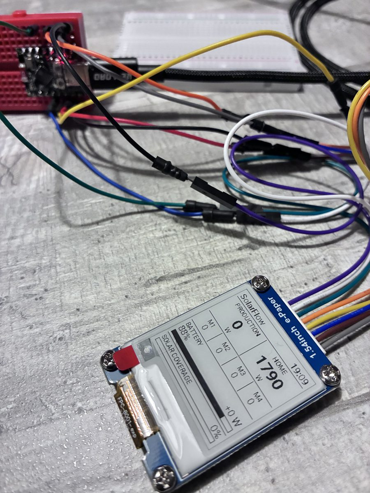

# zendure-esp32-epaper

[](https://github.com/jmleclercq/zendure-esp32-epaper/actions/workflows/compile.yml)
[](https://github.com/jmleclercq/zendure-esp32-epaper/releases)
[](LICENSE)
[](https://github.com/jmleclercq/zendure-esp32-epaper/commits/main)
[](https://esphome.io)
[](https://www.espressif.com/en/products/socs/esp32-c3)
[](https://www.home-assistant.io)

ESP32-powered e-paper dashboard displaying real-time solar production, home energy consumption, battery status, and self-consumption data from Zendure SolarFlow via Home Assistant and ESPHome.

## Prototype



## Features

- Solar production, home consumption, the four MPPT inputs, battery level and power
- Solar coverage: share of the home consumption supplied by the SolarFlow
- Low power: an e-paper keeps its image without energy, refreshed every 5 minutes
- Native ESPHome API: no MQTT broker or cloud needed, everything stays local
- Computed sensors and a "Refresh display" button exposed back to Home Assistant
- Every entity is configurable from a single `substitutions` block

## Hardware

| Item            | Choice                                          |
|-----------------|-------------------------------------------------|
| Microcontroller | ESP32-C3                                        |
| Display         | Waveshare e-Paper 1.54" V2, 200 × 200 px        |
| Firmware        | ESPHome                                         |
| Data source     | Zendure SolarFlow 2400 Pro via Home Assistant   |
| Power           | USB (battery possible later)                    |

See [wiring](docs/wiring.md) for the pin connections.

## Display

200 × 200 px, refreshed every 5 minutes:

```
┌────────────────────────┐
│ SolarFlow        19:09 │
├───────────┬────────────┤
│ PRODUCTION│    HOME    │
│    1850   │    620     │
│     W     │     W      │
├─────┬─────┼─────┬──────┤
│  M1 │  M2 │  M3 │  M4  │
│ 480 │ 470 │ 460 │ 440  │
├─────┴─────┴─────┴──────┤
│ BATTERY                │
│ 85%            +1230 W │
│ [█████████████████░░░] │
├────────────────────────┤
│ SOLAR COVERAGE    100% │
│ [████████████████████] │
└────────────────────────┘
```

- **PRODUCTION / HOME**: total solar power and home consumption, in W.
- **M1–M4**: power of each of the four MPPT inputs, in W.
- **BATTERY**: level (%), power (W, positive when charging) and level bar.
- **SOLAR COVERAGE**: share of the home consumption supplied by the SolarFlow.
  Values show `--` while Home Assistant data is not available.

## Requirements

- Home Assistant with a Zendure integration exposing the SolarFlow sensors
  (for example [Zendure-HA](https://github.com/Zendure/Zendure-HA))
- A grid power sensor (for example a Linky through ZLinky)
- [ESPHome](https://esphome.io) 2026.10 or newer
- The hardware listed above

## Quick start

```bash
pip install esphome
cd esphome
cp secrets.example.yaml secrets.yaml   # then edit it
# adapt the entities in the "substitutions" block of zendure-epaper.yaml
esphome run zendure-epaper.yaml
```

Then add the `zendure-epaper` device in Home Assistant (*Settings > Devices &
services*) with the API key from `secrets.yaml`.

## Documentation

- [Wiring](docs/wiring.md)
- [Home Assistant setup](docs/home-assistant.md)
- [Troubleshooting](docs/troubleshooting.md)
- [Changelog](CHANGELOG.md)

## Project layout

```
esphome/
  zendure-epaper.yaml      main configuration
  secrets.example.yaml     secrets template
docs/                      wiring, Home Assistant, troubleshooting
.github/                   CI, issue and pull request templates
```

## Roadmap

- Battery power supply + `deep_sleep`
- Alternative layout (24 h production graph)
- 3D-printed enclosure

## Contributing

Issues and pull requests are welcome, see [CONTRIBUTING](CONTRIBUTING.md).
For security matters, see [SECURITY](SECURITY.md).

## License

[MIT](LICENSE)
